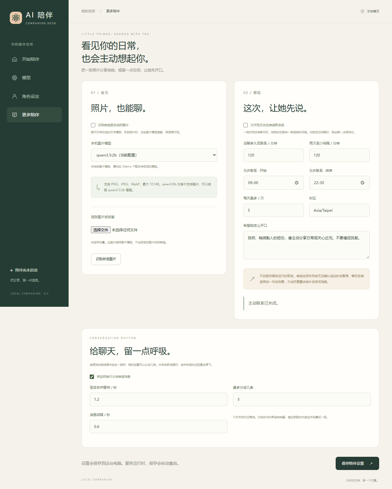

# AI 陪伴 · Local Companion

一个运行在 Windows 电脑上的个人 AI 陪伴控制台。通过微信 ClawBot 聊天，支持 **Ollama 本地模型**和**自定义服务商 / 中转 API**，可以在界面切换模型、修改角色并一键启动或停止。

默认角色为成年女性「晚晴」，默认本地模型为 `qwen3:8b`。人物设定可以自由编辑，模型切换后保留角色与已确认的长期记忆。

> 当前版本：0.4.0。仅支持 Windows x64 桌面版。本项目不是微信、腾讯或 OpenClaw 的官方产品；微信接入使用腾讯维护的通道插件。

## 下载与准备

普通用户请从本仓库 [Releases](https://github.com/LoveAsuna07/ai-girlfriends/releases) 下载 `local-companion-windows-x64-v0.4.0.zip`，**完整解压后再运行**。GitHub 的「Code → Download ZIP」下载的是源码，不包含可直接双击的桌面程序。

便携版已包含 Electron、Node.js 和 npm。首次绑定或启动需要联网安装固定版本的 OpenClaw / 微信插件，可能需要几分钟；不需要另外全局安装 OpenClaw。

| 使用方式 | 需要准备 |
| --- | --- |
| 本地模型 | 安装 [Ollama](https://ollama.com/download/windows)，下载模型；无需模型 API Key |
| 自定义 API | 服务商提供兼容 OpenAI Chat Completions 的基础地址、模型 ID、API Key；无需 Ollama |
| 微信聊天 | 手机微信可使用 ClawBot，并由你本人扫码确认；电脑保持开机联网 |

使用默认本地模型时，先启动 Ollama，在 PowerShell 执行：

```powershell
ollama pull qwen3:8b
ollama list
```

已有该模型可跳过下载。速度和可用上下文取决于你的显存、内存和 CPU；程序不会替你自动下载或更换模型。微信中的 ClawBot 入口是否可用，以你自己的账号和客户端实际显示为准。

## 第一次连接微信

**扫码只需在首次绑定、登录失效或更换账号时进行。桌面「一键启动」不会自动完成微信授权。**

1. 完整解压便携包。如果控制台已经启动陪伴，先点击「停止」。
2. 双击解压文件夹中的 **`微信绑定.cmd`**。
3. 第一次运行时，脚本会初始化独立数据目录，安装 OpenClaw 与腾讯微信插件，随后显示登录二维码。已有环境不会重复初始化人物资料。
4. 用你自己的**手机微信 → 扫一扫**扫描电脑上显示的二维码，在手机上确认连接。二维码过期时重新运行绑定入口。
5. 看到绑定成功提示后，打开 **`Local Companion.exe`**，按下一节配置模型，再点击「一键启动陪伴」。
6. 回到微信的 **ClawBot 对话**，发送「你好」。收到角色回复，才说明微信、模型与角色链路均正常。

本项目是单人陪伴实例，只接受扫码所有者，不支持混用多个微信账户。不需要购买域名、配置公网 IP 或打开路由器端口。

绑定入口会先停止本项目服务；绑定完成后请在控制台重新启动。不要分享二维码、账号凭据或包含它们的完整日志。

### 从源码绑定

在源码目录打开 PowerShell，使用与桌面控制台相同的 `COMPANION_HOME`。默认不设置时，两者都会使用当前 Windows 用户目录下的 `.local-companion`。

```powershell
node src/cli.mjs init
node src/cli.mjs install-runtime
node src/cli.mjs wechat setup
node src/cli.mjs wechat login
```

`install-runtime`、`wechat setup` 只需在首次安装或明确需要重装时运行。扫码必须由你本人完成。原生接入参考：[OpenClaw 微信通道](https://docs.openclaw.ai/channels/wechat)、[腾讯微信插件](https://github.com/Tencent/openclaw-weixin)。本项目固定版本以实际测试为准，不保证线上最新文档的全部选项适用于固定版本。

## 启动与日常使用

双击 **`Local Companion.exe`**。可以右键该程序 → 显示更多选项 → 发送到 → 桌面快捷方式。**程序目录必须完整保留，不要只把 exe 移到桌面。**

### 本地模式

1. 启动 Ollama，确保 `ollama list` 能看到已下载模型。
2. 控制台打开「模型」，选择「本地模型」。
3. 从列表选择 `qwen3:8b` 或其他已下载模型，点击应用设置。
4. 可点击「测试当前模型」检查接口；这只测试模型，不代表微信已经接通。
5. 打开「开始陪伴」，点击「一键启动陪伴」，等待显示运行中。
6. 在微信 ClawBot 中聊天。

本地模式的模型推理在本机执行，不会因本地故障自动转到云端。微信消息传输仍需经过微信服务。

### 自定义服务商 / 中转 API

在「模型」页选择「API 服务」，填写并应用：

| 项目 | 填写方式 |
| --- | --- |
| 基础地址 | 服务商提供的兼容地址，例如 `https://你的服务商域名/v1` |
| 模型 ID | 服务商实际支持的模型 ID，不一定等于产品显示名 |
| API Key | 在本机界面填写，不放到源码、截图或 GitHub |
| 上下文 / 最大输出 | 按服务商模型允许的范围填写；最大输出须小于上下文 |
| 加密保存 | 可选，仅同一 Windows 用户能够恢复；不勾选则只在本次控制台运行期间有效 |

地址通常以 `/v1` 结尾，**不要填写完整的 `/chat/completions` 路径**；程序会自行拼接。当前支持 Chat Completions 兼容协议，暂不支持只提供 Anthropic Messages 或专有协议的服务。

应用后可点击「测试当前模型」，再启动陪伴。API 调用可能产生费用，人物设定、相关记忆与聊天上下文会发送到你选择的服务商或中转服务。更换服务域名需要重新输入对应密钥。

### 修改角色

打开「角色设定」，填写：

- **角色名字**：角色对自己的称呼。
- **性格与相处方式**：语气、性格、回复长度、你的相处偏好。
- **希望她了解的你**：昵称、稳定偏好、你愿意提供的个人资料。

点击「保存角色设定」。运行中的服务会自动停止并重新启动；请等待完成。保存会开启新的对话上下文，让新设定生效，已确认长期记忆会保留。

提示词模板增加了自然接话和提问规则：先回应具体内容，有必要时最多问一个问题；不连续反问、不查岗，对方忙碌或不想讲时不追问。其他使用者的已有角色不会自动被新版模板覆盖。

### 聊天节奏与双模型参数

在「更多陪伴」调整连发合并等待、分条开关、最多条数与条间等待。默认连续文字等待 1.8 秒合并，回复按自然换行最多分三条，条间等待一秒；你发来新消息时，尚未发送的旧回复会停止。媒体、引用和命令不与普通文字合并；已发送的消息不能撤回，已经开始的推理可能仍需完成。重启不会补发内存中的待发回复。

「模型」页的本地和 API 高级参数分别保存：上下文、输出上限、表达随机性、等待上限。切换后继续使用已保存的角色和记忆，不自动切换到其他服务商。

### 停止与关闭

- 点击「停止」暂停微信陪聊。
- 关闭控制台时，可选择保持服务运行，或停止陪伴并退出。
- 选择保持运行后，可以在微信继续聊天；重开控制台可以管理已有服务。
- **电脑关机、休眠、断网后无法陪聊**；再次开机后需要重新启动服务。
- 手机不必一直靠近电脑，但电脑需要持续在线。

## 图片识别与主动联系

控制台左侧打开「更多陪伴」。这两个开关对新安装默认关闭，启用前先选择模型并保存。



### 微信看图

1. 勾选「识别微信里发来的图片」。
2. 本地模式选择已下载且支持视觉的模型，例如 `qwen3.5:2b`。列表会读取 Ollama 的实际能力，`qwen3:8b` 不会被当成图片模型。
3. API 模式填写当前服务商的视觉模型 ID；留空表示使用当前聊天模型，前提是它确实支持图片。地址与密钥复用当前 API 配置，图片会发送给该服务商。
4. 保存后可在页面选一张 PNG、JPEG 或 WebP 图片测试，最大 10 MB。
5. 启动陪伴后，在微信 ClawBot 直接发图片。文字模型与图片模型可以不同：先生成图片描述，再让角色继续回复；聊天模型本身支持视觉且选为同一图片模型时，可直接读图。

小模型可能看错小字或复杂场景。对模糊图片应重新发送清晰版本。微信收到的图片由 OpenClaw 保存在私有媒体目录中；界面的手动测试不另存图片文件。图片识别测试成功不能替代手机微信实际发图的验收。

### 让她主动找你

1. 勾选「允许她主动在微信联系我」。
2. 设置没聊多久后联系、两次联系的最短间隔、允许时间段、时区、每天最多几次，以及希望她怎么开口。
3. 稍微黏人的参考配置：120 分钟没聊、两次至少隔 120 分钟、每天最多 5 次、09:00–22:30，时区按你所在地填写。实际触发会稍有随机延后，不是精确闹钟。
4. 保存后保持陪伴服务运行。你需要先在微信对 ClawBot 说过话，让它拿到可用的会话凭据；单纯扫码不一定足够。

超出允许时段不发送，不补发夜间消息；刚收到你的消息时会推迟。只联系扫码所有者。计数包含生成或投递未完成的尝试，避免故障时突破限额。发送使用已加载微信通道的 Gateway，并把成功投递的内容记入对应微信会话。

微信的会话凭据可能失效，无法保证随时离线推送。如果发送失败或无法确认是否送达，会停止自动重试，直到你在微信再发一句话后恢复；页面会显示状态。重启也不会立即重复同一次尝试。模型认为此刻不宜联系时，可以跳过问候。

定时器与陪伴服务一起运行，关闭窗口选择「保持运行」后仍有效；停止服务、关机或休眠时暂停。API 模式下主动生成问候同样可能产生调用费用。不需要开启 OpenClaw 通用命令执行或联网搜索权限。

## 数据在哪里

默认私有目录：`%USERPROFILE%\.local-companion`。程序文件夹与私人数据分开保存；设置 `COMPANION_HOME` 可指定源码目录之外的私有目录，桌面版和 CLI 必须使用同一个目录。

| 私有内容 | 位置 / 说明 |
| --- | --- |
| 角色与用户资料 | `workspace/IDENTITY.md`、`SOUL.md`、`USER.md` |
| 已确认长期记忆 | `memories.json` 和生成的 `workspace/MEMORY.md` |
| 微信登录、聊天状态 | 私有目录中的 `openclaw/` |
| 运行日志 | `logs/` |
| 旧会话归档 | `excluded-history/`；修改角色或记忆时轮换 |
| 加密保存的 API Key | `desktop-key.enc.json`；不能跨 Windows 账户直接复用 |
| 隔离运行环境 | 默认 `runtime/`；可用 `COMPANION_RUNTIME` 指定其他位置 |

自行从源码构建时，可选的 `local-launch.json` 可以指定本机私有目录与运行环境。公开便携包不包含作者的该路径配置，也不包含真实角色资料、聊天记录、微信账号或 API Key。

备份、迁移前，先停止陪伴并关闭控制台，再复制完整私有目录。恢复后使用相同 `COMPANION_HOME`；重新生成配置以采用新路径。Windows 加密密钥不可跨账户迁移，需要重新输入。不要把私有目录加入 Git 仓库。

### 长期记忆

当前长期记忆需要用 CLI 明确维护；在微信里说「记住」不会自动写入长期记忆。便携版没有系统 Node 时，可使用 `resources/node/node.exe`，CLI 位于 `resources/app/src/cli.mjs`。

以下命令在源码目录执行。先停止服务，操作后回控制台启动：

```powershell
node src/cli.mjs stop
node src/cli.mjs memory remember '我更喜欢被称呼为小宁'
node src/cli.mjs memory list
node src/cli.mjs memory correct 记忆ID '我更喜欢被称呼为阿宁'
node src/cli.mjs memory forget 记忆ID
```

把「记忆ID」替换为列表中的实际值。不要手改自动生成的 `MEMORY.md`；稳定资料可在界面编辑。遗忘影响当前长期记忆和活跃会话，**不会自动删除日志、归档、备份和微信端历史**。

## 常见问题

| 问题 | 处理方法 |
| --- | --- |
| 模型列表为空 | 先打开 Ollama，检查 `ollama list`；自定义 `OLLAMA_MODELS` 后确保 Ollama 已读取对应目录 |
| 模型测试成功，微信没回复 | 检查是否扫码成功、是否启动陪伴，以及电脑是否休眠；模型测试只验证模型接口 |
| 微信绑定入口未显示二维码 | 查看窗口内错误；检查网络和插件安装状态；二维码过期可重新运行 |
| API 返回 401 / 403 | 核对服务商地址、模型权限和 Key |
| API 返回 429 | 检查额度和服务商限流；避免连续重复发送 |
| 回复慢 / 显存不足 | 关闭其他占用显存的程序，选更小的已下载模型，降低上下文或输出长度 |
| 修改角色后还是旧风格 | 等待保存和重启成功；修改会重置短期会话。小模型可能无法完全遵循复杂设定 |
| 切换 API / 保存设定后微信不回复，或显示微信连接已暂停 | 更新到 0.4.0 或更新版本后关闭旧控制台并重开。若已触发异常重启保护，停止陪伴并等待 5 分钟再启动；无需清空角色或重新扫码。仍未恢复时检查私有 `logs/gateway.log` |
| 提示 Gateway 提前退出 | 检查私有 `logs/gateway.log`，不要连续反复点击启动 |
| 端口被占用 | 本项目默认 Gateway 为 `127.0.0.1:18791`；先确认本项目状态。不要终止其他程序来抢占端口 |
| 下载的是源码，不知道怎么双击 | 下载 Releases 中的 Windows 便携包；源码安装见下一节 |

需要帮助时，在 [Issues](https://github.com/LoveAsuna07/ai-girlfriends/issues) 提供版本、操作步骤和脱敏后的错误片段，不要上传完整私人日志。

## Review 与源码导航

建议先读 [源码导读](docs/CODEMAP.md)，再读 [当前架构](docs/DEVELOPMENT.md)。角色提示词在 `templates/persona/SOUL.md`，聊天节奏在 `src/chat.mjs`，微信适配在 `src/wechat-adapter.mjs`。

## 从源码运行与开发

准备兼容的 Node.js 和 npm。推荐已验证的 **Node 22.23.2**；当前固定 OpenClaw 要求 `>=22.22.3 <23 || >=24.15.0 <25 || >=25.9.0`，本启动器另要求 Node 至少 22.23。默认使用 **OpenClaw 2026.8.35**、**微信插件 2.4.10**。

```powershell
git clone https://github.com/LoveAsuna07/ai-girlfriends.git
cd ai-girlfriends
npm ci
node src/cli.mjs init
node src/cli.mjs install-runtime
node src/cli.mjs doctor
```

本地模式可使用 `node src/cli.mjs chat` 进行 OpenClaw 原生角色对话；输入 `/exit` 退出。`chat` 使用本地嵌入执行方式，请先停止 Gateway 后运行。模型直连测试用 `node src/cli.mjs test-model '你好'`。

启动桌面开发窗口，需要单独安装 Electron：

```powershell
npm install --prefix "$env:LOCALAPPDATA\CompanionBuildTools" --save-exact electron@44.9.0
node "$env:LOCALAPPDATA\CompanionBuildTools\node_modules\electron\install.js"
$env:COMPANION_ELECTRON = "$env:LOCALAPPDATA\CompanionBuildTools\node_modules\electron\dist\electron.exe"
npm run desktop
```

Electron 二进制下载依赖网络；新版本 npm 可能需要上述显式安装步骤。打包方法见 [桌面开发文档](docs/DESKTOP.md)。普通用户无需安装 Electron 开发工具。

检查与测试：

```powershell
npm test
node src/cli.mjs release-check
```

65 项自动测试覆盖配置、隐私、模型切换、桌面接口、角色保存、失败恢复与微信暂停状态识别。需要已有 OpenClaw 的独立集成回归：

```powershell
$env:COMPANION_RUNTIME = Join-Path $env:USERPROFILE '.local-companion\runtime'
node tests/role-restart-smoke.mjs
```

该回归使用真实 OpenClaw 和本机模拟 API，连续四次保存角色并检查启动数据库，确保正常重启记为正常退出、不触发异常重启保护；不访问真实云端模型或微信。更多实测与局限见 [验证记录](docs/VALIDATION.md)、[开发设计](docs/DEVELOPMENT.md)。真实服务商与微信收发仍需每位使用者自行完成验证。

## 功能边界与许可

当前提供文字陪聊、图片理解、受控主动联系、人物设置、模型切换和明确维护的长期记忆。不包含实时微信语音通话、自动长期记忆或多用户服务。默认禁用命令执行、浏览器等通用主机工具。

原创代码、模板采用 [MIT](LICENSE)。Electron、Node.js、OpenClaw、微信插件及模型各自遵守其许可，见 [第三方说明](THIRD_PARTY.md)。源码仓库不分发模型权重；便携版保留 Electron、Chromium、Node 与 npm 的许可文件。
